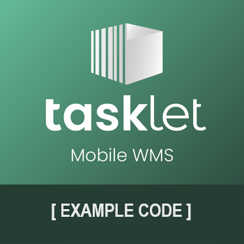

# Toggle RegisterQtyByScan on Pick Lines

This example customizes Tasklet Mobile WMS for Dynamics 365 Business Central to toggle quantity registration by barcode scan on individual pick lines.

## Behavior

The mobile action switches the `Register Qty. by Scan` field on the selected warehouse pick or inventory pick Take line. When pick lines are retrieved, the extension applies this setting to the mobile line, including barcode quantities when enabled. The field defaults to off.

## Structure

- `app.json`: Extension metadata, dependencies, and resource folder configuration.
- `src/PickRegisterQty.Codeunit.al`: Application tweak registration, toggle handling, and pick line configuration.
- `src/PickRegisterQty.TableExt.al`: Per-line quantity registration setting on Warehouse Activity Line.
- `resources/PickRegisterQtyByScan.xml`: Mobile application tweak.
- `ExampleLogo.png`: Shared example extension logo.

## Requirements

- Business Central 27.0 or later, with AL runtime 16.0.
- Tasklet Mobile WMS 5.57.0.0 or later.

## Setup

1. Set the publisher in `app.json` and download the dependency symbols.
2. Build and publish the extension to a test environment.
3. Refresh the mobile configuration so the application tweak is downloaded.
4. On a pick Take line, use the "Enter Qty." action to toggle quantity registration by scan. The pick lines refresh after a successful toggle.

The extension uses object ID range `60100-60149`, with codeunit, table extension, field, and tweak ID `60100`.

## Object Numbers

Renumber and rename the objects before using this code in a production environment. Changing the table extension or field ID after installation requires a data migration plan.

## Disclaimer

This example extension is provided as-is. Please carefully validate and test the code and any solution built from it. The code is not supported to the same degree as Mobile WMS, but we aim to keep it up to date as Business Central and Mobile WMS evolve.

Please report bugs directly in GitHub.